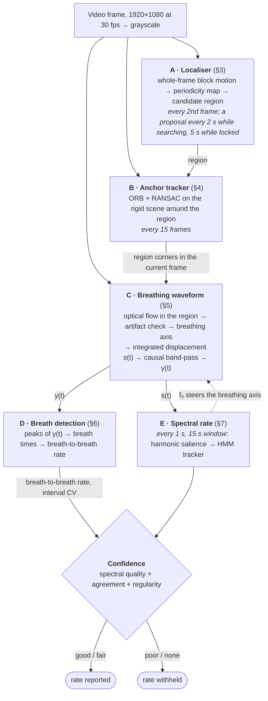
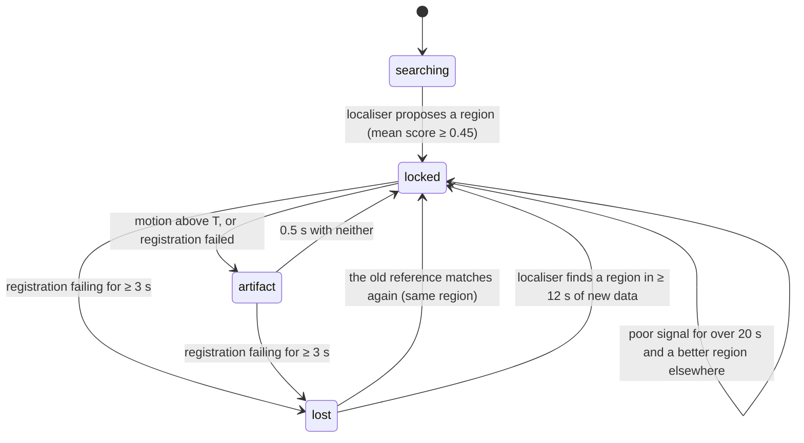

# MouseRespCam — algorithm description

This document describes how MouseRespCam estimates the respiratory rate of an anaesthetised mouse
from an ordinary webcam during stereotaxic surgery. It covers each processing stage and its
parameters, why each design choice was made (including alternatives we tried and rejected), and
the prior work the method builds on. Numbers in brackets, e.g. [4], link to the original
publication; full citations are in the [References](#references).

All parameter values quoted here are the defaults in `src/surgeryvitals/config.py`.

The figures and animations come from the recordings. The package's own code produced every
value they show; nothing is drawn by hand. To regenerate them, run
`.venv/bin/python docs/figures/make_figures.py all` (it needs the videos in `videos/`).

---

## 1. Problem and constraints

The footage: a consumer webcam (1920×1080, 30 fps) beside a stereotaxic frame. The mouse is
small in the image (roughly 250×200 px). The surgeon's gloved hands and gown move around and
over it. The camera is sometimes bumped or repositioned during a session. The webcam's
automatic exposure changes brightness whenever the scene changes.

The signal: under isoflurane, each breath is a short, sharp displacement of the flank or back
(about 0.2 s), followed by a long pause. Rates in our recordings were 36–100 breaths/min. Typical
inhalant-anaesthesia ranges reported in the literature are about 40–100 breaths/min [[20](https://doi.org/10.1093/ilar/ilab016)], and
institutional guidance targets about 55–100 [[21](https://az.research.umich.edu/animalcare/guidelines/guidelines-anesthesia-and-analgesia-mice/)].

Design goals:
1. **Hands-off.** No markers and no mandatory user input; the user may override the region.
2. **Causal and real-time.** Every step uses only past frames, so recorded video (replayed in
   simulated real time) and a live camera go through identical code. Because the rate is computed
   from a fixed sample rate, a live camera is resampled onto a uniform time grid at its *measured*
   frame rate (driver-reported rates are often wrong, and webcams slow down in dim light); see
   `source.py`.
3. **Honest.** When the rate cannot be trusted, the system withholds it instead of reporting a
   wrong number.

## 2. Pipeline overview

Monitor states: `searching` (no region yet), `locked` (tracking, signal usable), `artifact`
(tracking, but current samples rejected), and `lost` (scene changed; trying to re-acquire).

A region drawn by hand moves the monitor to `locked` from any state. Re-running
auto-detection (key `A`) returns it to `searching`.

## 3. Stage A — automatic localisation of the breathing region

**Idea.** Anything in the image that moves *rhythmically at a breathing rate* is a candidate.
The surgeon's movements are large but not periodic in that band. Background is static. The
mouse's flank is small in amplitude but highly periodic. So the region is defined by
*periodicity*, not by appearance. This means no detector has to be trained. A related principle,
finding the respiratory region from the intrinsic properties of respiratory motion, was proposed
for human video monitoring by Janssen et al. [[10](https://doi.org/10.1088/0967-3334/37/1/100)].

*Figure 1 (animation, 2× speed). Localisation on Recording 3, from the first frame. The
surgeon's hand moves hundreds of pixels but not rhythmically, so it scores low. The mouse
block moves a few pixels, once per breath. After the 12 s minimum history the map picks out the
mouse, and the region (green) is locked.*

**Block motion.** Every second frame (15 Hz), the frame is resized to 480 px wide (`INTER_AREA`;
exactly ¼ of 1080p, which is ~100× faster than a non-integer ratio). Rows are cropped to a
multiple of 8, giving a 60×33 grid of 8×8 blocks, each ≈32×32 px at full resolution. Dense
optical flow [[1](https://doi.org/10.1007/3-540-45103-X_50)] (Farnebäck: pyramid scale 0.5, 3 levels, window 9, 3 iterations, poly_n 5,
σ 1.1) is computed between consecutive localiser frames and averaged per block. This gives one
2-D velocity per block per sample. The flow runs on a worker thread; OpenCV releases the GIL,
so it overlaps with decoding and the region processing.

**Periodicity score.** Over the last 20 s (≥12 s needed):
1. Integrate velocity to displacement and band-pass 0.1–5 Hz (zero-phase Butterworth, order 2;
   zero-phase is allowed here because it runs on a stored buffer).
2. Project each block onto its dominant direction, θ = ½·atan2(2cxy, cxx − cyy),
   from the block's 2×2 displacement covariance.
3. Compute the Hann-windowed power spectrum P(f) and the harmonic sum
   H(f) = Σk=1..3 P(k·f) [[11](#references), [12](https://doi.org/10.1121/1.396427)]. The block's rate f₀ is the argmax of H within 30–210 breaths/min.
4. Score = power within ±0.08 Hz of f₀, 2f₀, 3f₀ divided by total power in 0.1–6 Hz.

The score is a spectral-concentration measure, close in spirit to the SNR used in camera-based
pulse measurement [[14](https://doi.org/10.1109/TBME.2013.2266196)]. Because the denominator includes slow motion (0.1–0.5 Hz), blocks
dominated by the surgeon score low.

*Figure 2. The periodicity score for three blocks (Recording 3, window 0–20 s). Shaded bands:
the ±0.08 Hz windows around f₀, 2f₀ and 3f₀ that make up the score's numerator. Grey: below
the 30/min search band. The mouse block puts 80% of its power at the breathing rate and its
harmonics. The glove block moves over 100× more, but slowly, so it scores 0.03. The background is
removed by the absolute noise floor.*

**Two pitfalls found on our data, and their fixes:**
- *The surgeon breathes too.* The gown and hands move at the surgeon's breathing rate
  (12–20/min), and that region is far larger than the mouse. The search band therefore starts
  at 30 breaths/min. ([exploration figure 07](../exploration/) shows the failure before this fix.)
- *Relative amplitude gates fail.* Keeping only blocks that move more than the median block
  removed the mouse whenever the surgeon was active. Blocks are instead kept if their amplitude
  exceeds 3× the 10th percentile of all blocks, i.e. an absolute noise floor set by the static
  background.

**Region selection.** Blocks above a threshold τ = min(0.5, max(0.3, 0.8 × 98th percentile of
scores)) are grouped per candidate rate (±4 breaths/min) into 8-connected components. The
component maximising mean score × √(number of blocks) wins: strong and coherent, with area
counting only weakly. It needs ≥3 blocks and a mean score ≥0.45. Its bounding box becomes the
region.

*Figure 3. From the score map to the region (Recording 3, t = 20 s). Here τ is at its 0.30
floor. The winning group is 19 connected blocks sharing a rate of 46/min, on the mouse's back
beside the ear bar.*

**Schedule.** A proposal is attempted every 2 s while searching. While locked, the map is
refreshed every 5 s (for the optional "Breathing map" overlay and for relocation). An
automatically found region is replaced only if its confidence has been poor for >20 s and the
new proposal overlaps the old one by IoU < 0.3.

## 4. Stage B — keeping the region on the mouse (anchor tracking)

**Key decision: track the surroundings, not the mouse.** A tracker locked onto the mouse would
follow the breathing motion and remove exactly the signal we want. The mouse is fixed in the
stereotaxic frame, so we instead register the *rigid scene around it* (ear bars, platform, tape)
and carry the region along.

*Figure 4. Why the region must not follow the mouse (Recording 3, 32–45 s). For this figure,
a sub-pixel template tracker was run on the region. It does follow the mouse, but it does so by
moving with every breath (a). The motion left inside its window is only 44% of the signal
(standard deviation), and it is distorted (b). The fixed, scene-anchored region keeps the
whole breath.*

- ORB features [[2](https://doi.org/10.1109/ICCV.2011.6126544)] (up to 1500, FAST threshold 10) on a half-resolution frame. The region itself
  is masked out of the reference.
- Every 15 frames (0.5 s): match current features to the reference (brute-force Hamming, k = 2,
  Lowe ratio test 0.8 [[4](https://doi.org/10.1023/B:VISI.0000029664.99615.94)]). Then fit a 4-degree-of-freedom similarity transform with RANSAC [[3](https://doi.org/10.1145/358669.358692)]
  (`cv2.estimateAffinePartial2D`, reprojection threshold 4 px). The fit is accepted if it has
  ≥25 inliers and scale in (0.8, 1.25).
- When the transform updates, the *previous* region patch is re-sampled with the new transform.
  The tracking correction itself therefore never appears as motion.

*Figure 5. Registration across a sudden camera bump. This uses the synthetic test video: Recording 3
footage shifted by a known (−300, −150) px at 90 s
(`exploration/scripts/make_dynamic_video.py`). The region is masked out of the reference (a), so
only the scene is matched. RANSAC keeps the 675 matches that agree, and the transform they
give carries the region onto the mouse (b).*

*Figure 6 (animation, 2× speed). A slow 500 px pan (synthetic test video, 150–160 s). The
region (green) is updated every 15 frames from the matched scene features (blue). The patch the
waveform is computed from (right) stays on the same part of the mouse throughout, and the
monitor stays `locked`.*
- **Re-keying.** Every 5 s, while tracking is good and the region is calm, the reference is
  refreshed from the current frame. New keypoints are mapped back through the inverse transform
  into the original reference coordinates, so the region does not drift (measured drift ≤3 px
  over 10 min). Without this, a reference captured while the surgeon's hand filled the view
  matched poorly once the hand moved: registration then hovered at the inlier limit and
  produced false artifacts.
- **Loss and recovery.** A failed registration flags the current samples as artifact. Failure
  for ≥3 s → `lost`: the localiser history is cleared and the signal reset. While lost, the old
  reference is still tried, so a briefly blocked view re-locks to the same region immediately.
  A moved camera is re-acquired by the localiser (≥12 s of new data).

## 5. Stage C — the breathing waveform

**Region patch.** The bounding box of the tracked region is cropped and area-downsampled by
s = max(0.25, 24 px / shorter side), then affine-warped to a fixed patch (typically ~70×45 px).

**Motion.** Farnebäck flow [[1](https://doi.org/10.1007/3-540-45103-X_50)] between consecutive patches (2 levels, window 9). For each frame
we keep the mean flow vector **v**t and the mean flow magnitude mt.
Optical flow was chosen over intensity-based signals because brightness here is dominated by
auto-exposure (exploration figure 01). In a comparison of three extractors for camera-based
human respiration, optical flow also outperformed the intensity-based ones in all tested
conditions [[16](https://doi.org/10.3390/s21155126)].

*Figure 7 (animation, real time). Stage C at work (Recording 3, 40–50 s). The region's flow
(arrows, magnified 30×) is averaged into one 2-D motion per frame. Integrated, it moves back
and forth along the breathing axis (middle). Its projection on the axis is s(t). Band-passed,
it becomes the displayed waveform y(t), in which each breath is an upward peak and is marked
once confirmed (§6).*

**Artifact rejection.** A frame is an artifact if mt > T or the last registration
failed; the flag is held for 0.5 s. During artifacts **v**t is set to zero (they are
not integrated). The threshold is

  T = clip(3 × median of per-second maxima of m over the last 60 s, 0.3, 3.0) px/frame.

It uses *all* frames, including flagged ones. Breaths therefore set the scale, and only motion
several times larger than a typical breath is rejected. An earlier version excluded flagged
frames from the baseline. That threshold ratcheted down until it rejected the breaths
themselves.

![Three stacked panels over 50 seconds of Recording 2. a: the region's flow magnitude on a log scale, with a spike train for the breaths that stays under the threshold line at about 0.67 pixels per frame, and a burst above it between 209 and 220 seconds, shaded as artifact. b: the integrated displacement s(t) rises steadily with a step per breath and stays flat inside the shaded artifact spans. c: the displayed waveform with orange markers on breaths before and after the artifact and none inside it.](figures/C1_artifact_rejection.png)

*Figure 8. Artifact rejection during a hand intrusion (Recording 2, 190–240 s). Breaths set the
threshold T (≈0.67 px/frame here), so only motion several times larger than a breath is flagged
(a). The intrusion reaches 4.3 px/frame. Flagged increments are not integrated, so s(t) holds
still instead of jumping (b), and no breaths are taken from the flagged samples (c).*

**Projection onto the breathing axis.** The 2-D motion is reduced to one signal:

  st = st−1 + **v**t · (p · **a**)

Here **a** is the breathing axis and p = ±1 the polarity. Integrating projected *increments*,
rather than projecting accumulated displacement, means changes to **a** never cause jumps.
Every second, **a** is updated as the principal eigenvector of a 2×2 matrix C, built from the
detrended 2-D displacement D over the last 15 s:
- If a trusted rate f₀ is available, C sums the cross-spectra at f₀, 2f₀ and 3f₀ (±0.08 Hz):
  C = Re Σ **X**(f)**X**(f)H. f₀ is taken from the last good/fair estimate within
  30 s, or else from regular breath intervals. This is a narrow-band spatial filter steered to
  the breathing frequency. It stops slow pushes or fast hand jitter from rotating the axis.
  Both happened in our data (Recording 2 at 460 s; Recording 1 after 175 s).
- Otherwise, C is the covariance of D band-passed to 0.2–5 Hz.

C is trace-normalised and smoothed (C ← 0.8·C + 0.2·Cnew), and the sign of **a** is
kept consistent with its previous value.

*Figure 9. Steering the breathing axis (Recording 2, 451–466 s). Here slow motion rotates the
broadband principal axis 39° away from the breathing direction. The axis steered to f₀ and its
harmonics stays on the breathing. Its projection has spectral quality 0.53 ("good", Stage E).
The broadband projection's 0.34 would fall below the 0.35 "fair" limit.*

**Polarity.** Breaths are sharp and the pauses between them are slow, so the waveform is
asymmetric. With α = ((q₉₉ − q₅₀) − (q₅₀ − q₁)) / (q₉₉ − q₁) of the band-passed projection, p is set
so that α > 0, i.e. breaths point **up**. The first decision needs ≥6 s of signal and |α| > 0.1.
A flip needs three consecutive 1-s checks with α·p < −0.15. Breath detection only runs once
polarity is decided, and restarts from the moment of any flip.

*Figure 10. Choosing the polarity (Recording 3, the first 6 s after locking). Breaths are brief
and the pauses long, so the median sits near the resting level. The spikes reach much further on
one side, which gives α = −0.73. Setting p = −1 makes breaths point up (b), as in the GUI and
for the peak detector.*

**Displayed waveform.** y(t) = causal 2nd-order Butterworth band-pass (0.2–4 Hz) of s(t),
applied sample by sample with stored filter state.

## 6. Stage D — breath-by-breath detection

Every third frame, peaks are searched in the last 15 s of y(t) (`scipy.signal.find_peaks`):
prominence ≥0.3 × (q₉₅ − q₅) of non-artifact samples, minimum distance 0.3 s (≤200/min),
prominence window 2.5 s. A peak is confirmed once it is 0.35 s old, is not in an artifact, and
comes ≥0.3 s after the previous breath. Confirmed breaths are final; they are written to
`breaths.csv`.

*Figure 11. Breath detection on the last 15 s of y(t) (Recording 3, 285–300 s). Each breath
clears the fixed prominence limit comfortably (orange bars). A peak in the last 0.35 s (shaded)
is not confirmed yet. The breath-to-breath rate is 60 / median interval. The interval CV, here
0.04, measures regularity for the confidence rule (§7).*

These limits are deliberately **fixed** and not derived from the tracked rate. In an earlier
version, the minimum peak distance was half the tracked period. When the spectral tracker
locked onto a sub-harmonic (one third of the true rate), the detector then skipped two of every
three breaths and "confirmed" the wrong rate.

The breath-to-breath rate is 60 / median interval of the breaths in the last 15 s. Intervals
longer than 2.5× the median (gaps) are dropped, and ≥3 intervals are needed. The coefficient of
variation (CV) of the intervals measures regularity.

## 7. Stage E — respiratory rate and confidence

Every second, with ≥8 s of signal:

1. **Clean segment.** Use the longest artifact-free run within the last 15 s; it must be ≥8 s.
   (Zeroed artifact samples otherwise leave a step that looks like slow periodic motion.)
2. **Spectrum.** Detrend, Hann window, FFT with nfft = 8192 (resolution 0.22 breaths/min).
   P(f) = 0 below 0.9 × 25/60 Hz.
3. **Harmonic-weighted salience.**
   Λ(f) = H(f) · √(P(f) / max P), where H(f) = Σk=1..3 P(k·f).
   The harmonic sum [[11](#references), [12](https://doi.org/10.1121/1.396427)] makes the fundamental of an impulsive waveform win over its
   harmonics. A plain harmonic sum, however, also rewards *sub*-harmonics: the candidate at f₀/3
   collects P(f₀) as its 3rd harmonic. Multiplying by the candidate's own power removes that
   failure, which we observed as false 13/min readings.

   

   *Figure 12. Why the salience is weighted (Recording 2, window ending at 60 s, about
   90/min). The harmonic sum (b) builds strong false candidates at f₀/3 and f₀/2. On a
   noisier window, these can overtake the true rate. The weighting by the candidate's own power
   (c) removes them.*
4. **Quality gate.** If the spectrum is not periodic (concentration at the argmax of Λ is
   < 0.3), the tracker is only propagated, not updated.
5. **HMM tracking.** States: 25–200 breaths/min in 0.5 steps. Transition: Gaussian drift
   (σ = 2 breaths/min per second) plus a 0.2% uniform jump probability, so it can re-lock.
   Emission: (Λ/max Λ)² + 0.02. Forward filtering only (causal); the estimate is the posterior
   mode. Temporal tracking of a spectral peak with an HMM follows pitch trackers such as pYIN
   [[13](https://doi.org/10.1109/ICASSP.2014.6853678)] and spectral tracking of heart rate from PPG [[15](https://doi.org/10.1109/TBME.2014.2359372)].

   

   *Figure 13. Tracking the rate over a whole session (Recording 2). Each column is the salience
   Λ of one 1 s update, normalised. The HMM follows the fundamental as the rate falls from about
   90 to 47/min. It is not pulled onto the second harmonic (the fainter band above) or onto
   short disturbances. The rate is withheld at 216–227 s, after the hand intrusion of Figure 8,
   until the window again holds 8 s of clean signal.*
6. **Confidence.** SQI = spectral concentration at the estimate (±0.1 Hz, 3 harmonics, relative
   to 0.1–6 Hz), compared with the breath-to-breath rate from Stage D:

   | confidence | SQI | spectral vs breath-to-breath | interval CV |
   |---|---|---|---|
   | good | ≥ 0.5 | within 15 % | < 0.25 |
   | fair | ≥ 0.35 | within 15 % | < 0.4 |
   | poor | otherwise | | |
   | none | not enough clean data | | |

   A rate is **reported only when confidence is good or fair**, i.e. when two independent
   estimators agree. This is the "smart fusion" principle of Karlen et al. [[17](https://doi.org/10.1109/TBME.2013.2246160)] for respiratory
   rate from PPG; see Charlton et al. [[18](https://doi.org/10.1109/RBME.2017.2763681)] for a review of such estimators. The regularity
   condition stopped two estimators that happened to agree on noise from passing.
   The GUI keeps showing the last valid value, dimmed, for up to 15 s.

   ![Five stacked panels over the 227 seconds of Recording 1. a: the spectral estimate, the breath-to-breath rate and the reported rate agree near 40 breaths per minute for most of the recording; near the end the spectral estimate drops to the 25 per minute floor and the reported rate stops. b, c and d: the spectral quality, the disagreement between the two estimates and the irregularity of breath intervals, each with its threshold lines. e: the resulting confidence strip, good and fair for most of the recording and poor where any rule fails.](figures/E3_confidence.png)

   *Figure 14. The confidence rule over a difficult recording (Recording 1, hands near the
   mouse throughout). A rate is reported (blue, 66% of the time) only when the spectrum is
   periodic (b), the two estimators agree (c) and the breathing is regular (d). Near the end the
   spectral tracker drops to the 25/min floor while breath counting stays near 40/min. That
   disagreement withholds the rate rather than reporting a wrong one.*

**Why the 25/min floor.** When the surgeon rests a hand on the frame, their own breathing
(12–20/min) reaches the region. With a 15/min floor the tracker locked onto it in Recording 1.
**Consequence:** a true rate below 25/min is shown as "withheld", not as a number, although
breaths still appear in the waveform. A dedicated apnoea/bradypnoea alarm based on time since
the last breath is planned.

## 8. Computational cost

Measured on an Apple M4 laptop with 1080p30 H.264 input, including decoding: about 3.5× real
time for one recording. The dominant cost is whole-frame Farnebäck flow, about 15 ms per call at
480×270 with OpenCV 5, run on every second frame on a worker thread. Region flow, registration
(every 15 frames) and the per-second spectral analysis are minor.

## 9. Validation status

There is **no ground truth yet**. What has been checked is internal consistency and visual
inspection of the waveform (figures in `exploration/`):

## 10. Related work and acknowledgements

- **Camera-based vital signs in rodents.** Kunczik et al. [[7](https://doi.org/10.1364/BOE.10.004422)] measured respiratory and heart
  rate of anaesthetised mice and rats from RGB video, reporting respiratory-rate RMSE of about
  1.4 breaths/min in mice. Respiration was derived from the tracked motion of the abdominal
  area in manually selected regions; the animals were not surrounded by a working surgeon.
  A later study extended camera-based respiration monitoring to unconstrained rodents [[19](https://doi.org/10.3390/ani13121901)].
  US patent 10,292,369 ("Non-contact detection of physiological characteristics of
  experimental animals") describes deriving respiration rate of experimental animals from
  an optical-flow signal. Anyone commercialising this tool should review it.
  MouseRespCam' contributions are the combination for the surgical setting: hands-off
  periodicity-based localisation, anchor tracking that does not cancel the breathing signal,
  surgeon-motion handling (search floor, artifact scale, axis steering) and confidence-gated
  reporting. Most importantly, it does not require any specialized hardwire for tracking.
- **Camera-based respiration in humans.** Optical flow outperformed intensity-based extractors
  (PCA, highest-variance pixels) in Romano et al. [[16](https://doi.org/10.3390/s21155126)]. Automatic respiratory region detection from intrinsic motion properties
  was proposed by Janssen et al. [[10](https://doi.org/10.1088/0967-3334/37/1/100)].
- **Signal processing.** Harmonic sum / sub-harmonic summation pitch estimation [[11](#references), [12](https://doi.org/10.1121/1.396427)]; HMM
  pitch tracking [[13](https://doi.org/10.1109/ICASSP.2014.6853678)]; spectral SNR as a quality measure [[14](https://doi.org/10.1109/TBME.2013.2266196)]; PPG heart-rate tracking [[15](https://doi.org/10.1109/TBME.2014.2359372)];
  agreement-based fusion of respiratory-rate estimators [[17](https://doi.org/10.1109/TBME.2013.2246160), [18](https://doi.org/10.1109/RBME.2017.2763681)].
- **Behavioural video analysis.** Facemap's motion SVD [[8](https://doi.org/10.1038/s41593-023-01490-6), [9](https://doi.org/10.1126/science.aav7893)] informed the exploration phase.
- **Software.** OpenCV [[22](https://web.archive.org/web/20250114082146/https://www.drdobbs.com/open-source/the-opencv-library/184404319)] (optical flow, ORB, RANSAC, video I/O), NumPy [[23](https://doi.org/10.1038/s41586-020-2649-2)], SciPy [[24](https://doi.org/10.1038/s41592-019-0686-2)]
  (filters, peak detection), Qt for Python (PySide6) and pyqtgraph (GUI), matplotlib (figures).

## References

1. G. Farnebäck, "Two-frame motion estimation based on polynomial expansion," in *Image Analysis
   (SCIA 2003)*, LNCS 2749, pp. 363–370, Springer, 2003. [doi:10.1007/3-540-45103-X_50](https://doi.org/10.1007/3-540-45103-X_50)
2. E. Rublee, V. Rabaud, K. Konolige, G. Bradski, "ORB: An efficient alternative to SIFT or SURF,"
   in *Proc. IEEE ICCV*, pp. 2564–2571, 2011. [doi:10.1109/ICCV.2011.6126544](https://doi.org/10.1109/ICCV.2011.6126544)
3. M. A. Fischler, R. C. Bolles, "Random sample consensus: a paradigm for model fitting with
   applications to image analysis and automated cartography," *Commun. ACM* 24(6):381–395, 1981.
   [doi:10.1145/358669.358692](https://doi.org/10.1145/358669.358692)
4. D. G. Lowe, "Distinctive image features from scale-invariant keypoints," *Int. J. Comput.
   Vision* 60(2):91–110, 2004. [doi:10.1023/B:VISI.0000029664.99615.94](https://doi.org/10.1023/B:VISI.0000029664.99615.94)
5. B. D. Lucas, T. Kanade, "An iterative image registration technique with an application to
   stereo vision," in *Proc. IJCAI*, pp. 674–679, 1981. [PDF (IJCAI proceedings)](https://www.ijcai.org/Proceedings/81-2/Papers/017.pdf)
6. T. Kroeger, R. Timofte, D. Dai, L. Van Gool, "Fast optical flow using dense inverse search,"
   in *Proc. ECCV*, LNCS 9908, pp. 471–488, 2016. [doi:10.1007/978-3-319-46493-0_29](https://doi.org/10.1007/978-3-319-46493-0_29)
7. J. Kunczik, C. Barbosa Pereira, L. Zieglowski, R. Tolba, L. Wassermann, C. Häger, A. Bleich,
   H. Janssen, T. Thum, M. Czaplik, "Remote vitals monitoring in rodents using video recordings,"
   *Biomed. Opt. Express* 10(9):4422–4436, 2019. [doi:10.1364/BOE.10.004422](https://doi.org/10.1364/BOE.10.004422)
8. A. Syeda, L. Zhong, R. Tung, W. Long, M. Pachitariu, C. Stringer, "Facemap: a framework for
   modeling neural activity based on orofacial tracking," *Nat. Neurosci.* 27(1):187–195, 2024.
   [doi:10.1038/s41593-023-01490-6](https://doi.org/10.1038/s41593-023-01490-6)
9. C. Stringer, M. Pachitariu, N. Steinmetz, C. B. Reddy, M. Carandini, K. D. Harris, "Spontaneous
   behaviors drive multidimensional, brainwide activity," *Science* 364(6437):eaav7893, 2019.
   [doi:10.1126/science.aav7893](https://doi.org/10.1126/science.aav7893)
10. R. Janssen, W. Wang, A. Moço, G. de Haan, "Video-based respiration monitoring with automatic
    region of interest detection," *Physiol. Meas.* 37(1):100–114, 2016.
    [doi:10.1088/0967-3334/37/1/100](https://doi.org/10.1088/0967-3334/37/1/100)
11. A. M. Noll, "Pitch determination of human speech by the harmonic product spectrum, the
    harmonic sum spectrum, and a maximum likelihood estimate," in *Proc. Symposium on Computer
    Processing in Communications*, vol. 19, pp. 779–797, Polytechnic Press, Brooklyn, 1970
    (symposium held 1969). Print only; no online version or DOI exists.
12. D. J. Hermes, "Measurement of pitch by subharmonic summation," *J. Acoust. Soc. Am.*
    83(1):257–264, 1988. [doi:10.1121/1.396427](https://doi.org/10.1121/1.396427)
13. M. Mauch, S. Dixon, "pYIN: A fundamental frequency estimator using probabilistic threshold
    distributions," in *Proc. IEEE ICASSP*, pp. 659–663, 2014. [doi:10.1109/ICASSP.2014.6853678](https://doi.org/10.1109/ICASSP.2014.6853678)
14. G. de Haan, V. Jeanne, "Robust pulse rate from chrominance-based rPPG," *IEEE Trans. Biomed.
    Eng.* 60(10):2878–2886, 2013. [doi:10.1109/TBME.2013.2266196](https://doi.org/10.1109/TBME.2013.2266196)
15. Z. Zhang, Z. Pi, B. Liu, "TROIKA: A general framework for heart rate monitoring using
    wrist-type photoplethysmographic signals during intensive physical exercise," *IEEE Trans.
    Biomed. Eng.* 62(2):522–531, 2015. [doi:10.1109/TBME.2014.2359372](https://doi.org/10.1109/TBME.2014.2359372)
16. C. Romano, E. Schena, S. Silvestri, C. Massaroni, "Non-contact respiratory monitoring using an
    RGB camera for real-world applications," *Sensors* 21(15):5126, 2021.
    [doi:10.3390/s21155126](https://doi.org/10.3390/s21155126)
17. W. Karlen, S. Raman, J. M. Ansermino, G. A. Dumont, "Multiparameter respiratory rate
    estimation from the photoplethysmogram," *IEEE Trans. Biomed. Eng.* 60(7):1946–1953, 2013.
    [doi:10.1109/TBME.2013.2246160](https://doi.org/10.1109/TBME.2013.2246160)
18. P. H. Charlton, D. A. Birrenkott, T. Bonnici, M. A. F. Pimentel, A. E. W. Johnson, J. Alastruey,
    L. Tarassenko, P. J. Watkinson, R. Beale, D. A. Clifton, "Breathing rate estimation from the
    electrocardiogram and photoplethysmogram: a review," *IEEE Rev. Biomed. Eng.* 11:2–20, 2018.
    [doi:10.1109/RBME.2017.2763681](https://doi.org/10.1109/RBME.2017.2763681)
19. L. Breuer, L. Mösch, J. Kunczik, V. Buchecker, H. Potschka, M. Czaplik, C. Barbosa Pereira,
    "Camera-based respiration monitoring of unconstrained rodents," *Animals* 13(12):1901, 2023.
    [doi:10.3390/ani13121901](https://doi.org/10.3390/ani13121901)
20. K. L. Navarro, M. Huss, J. C. Smith, P. Sharp, J. O. Marx, C. Pacharinsak, "Mouse anesthesia:
    the art and science," *ILAR J.* 62(1–2):238–273, 2021. [doi:10.1093/ilar/ilab016](https://doi.org/10.1093/ilar/ilab016)
21. University of Michigan Animal Care & Use Program, "Guidelines on anesthesia and analgesia in
    mice." [az.research.umich.edu](https://az.research.umich.edu/animalcare/guidelines/guidelines-anesthesia-and-analgesia-mice/)
22. G. Bradski, "The OpenCV library," *Dr. Dobb's Journal of Software Tools*, 2000.
    [Archived article](https://web.archive.org/web/20250114082146/https://www.drdobbs.com/open-source/the-opencv-library/184404319)
23. C. R. Harris et al., "Array programming with NumPy," *Nature* 585:357–362, 2020. [doi:10.1038/s41586-020-2649-2](https://doi.org/10.1038/s41586-020-2649-2)
24. P. Virtanen et al., "SciPy 1.0: fundamental algorithms for scientific computing in Python,"
    *Nat. Methods* 17:261–272, 2020. [doi:10.1038/s41592-019-0686-2](https://doi.org/10.1038/s41592-019-0686-2)
